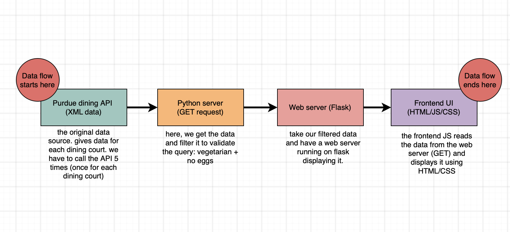

# Purdue Vegetarian Dining
Find all vegetarian and eggless dining options at the Purdue dining courts.

## The Problem
Every day, I have to look through the Purdue Menus app to find food that I can eat. This gets very tedious as it takes 4 clicks per food item per dining hall. This project aims to solve that by filtering out all options that are not marked as vegetarian and are marked as containing eggs.

## Project Goal
Create an easy to use website that filters the food options.

The MVP scope is to simply have a website that has the vegetarian+eggless food options at each dinign court on a given day.

## Roadmap
- [ ] Build MVP
- [ ] Make it more accessible by adding custom filters
- [ ] Add caching to make the server more efficient

## How It Works

## Tech Stack
- Python with Flask for the webserver
- HTML/CSS/JS for the frontend UI
